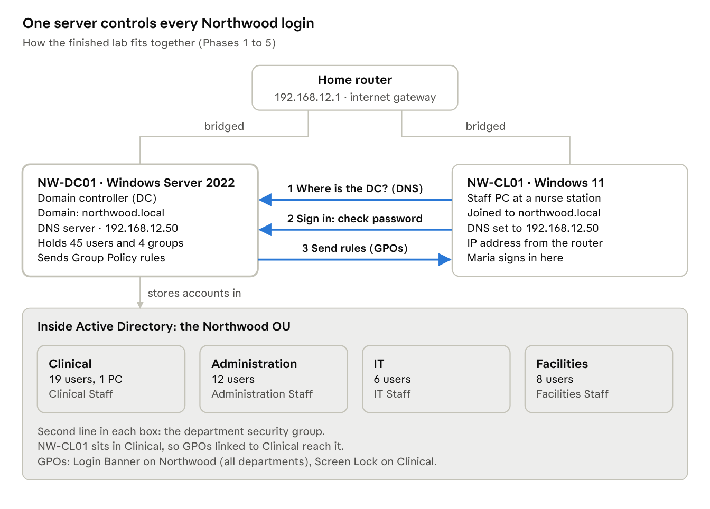

# Northwood Regional Health — Simulated IT Infrastructure Lab

## Project Purpose

This project simulates the IT infrastructure of a regional healthcare organization to demonstrate hands-on systems administration skills, including Active Directory deployment, Organizational Unit (OU) design, user/group provisioning, and Group Policy (GPO) management.

## Scope & Disclaimer

Northwood Regional Health is a **fictional organization** created solely for this lab. All user accounts, patient counts, and organizational details are simulated for demonstration purposes. No real patient data (PHI) or real organizational data is used at any point in this project.

## Organization Profile

Northwood Regional Health is a fictional healthcare organization with one main hospital, two satellite clinics, and about 350 staff.

This lab builds a scaled-down version of Northwood's IT environment. It keeps the real structure but uses a smaller number of accounts:

| | Full organization | Built in this lab |
|---|---|---|
| Staff accounts | ~350 | 45 (a sample from every department) |
| Departments | 4 | 4 OUs with a security group each |
| Domain controllers | — | 1 (NW-DC01) |
| Staff computers | — | 1 (NW-CL01, a Clinical workstation) |
| Group Policy | — | 2 GPOs: a login banner for all staff, a screen lock for Clinical |

The design reflects the access controls a HIPAA-adjacent healthcare organization would need.

### Departments

| Department | Represents |
|---|---|
| **Clinical** | Nurses (RN/LPN), Physicians, Radiology techs, Lab/Diagnostics techs |
| **Administration** | HR, Billing/Coding, Front Desk/Scheduling, Executive leadership |
| **IT** | Help desk/support techs, Systems admins, Network admins |
| **Facilities** | Maintenance, Janitorial, Security guards, Groundskeeping |

## Lab Architecture



**In plain terms:** one server (NW-DC01) controls every login at Northwood. Staff computers like NW-CL01 ask it who users are, check their passwords with it, and receive security rules from it. Both machines connect to the internet through a home router.

### The pieces

| Component | What it is | Role in the lab | Address |
|---|---|---|---|
| **Home router** | The network's gateway | Connects the lab to the internet | 192.168.12.1 |
| **NW-DC01** | Windows Server 2022 | Domain controller and DNS server for `northwood.local`. Stores all accounts and sends out Group Policy | 192.168.12.50 (static) |
| **NW-CL01** | Windows 11 Enterprise | A staff workstation (a nurse-station PC) joined to the domain | Assigned on the home network; DNS points to NW-DC01 |
| **Active Directory** | The account database on NW-DC01 | Holds 45 users and 4 security groups, organized into department OUs | — |
| **Group Policy** | Rules linked to OUs | Login banner for all of Northwood; 5-minute screen lock for Clinical | — |

### How a staff login works

1. **Find the server.** NW-CL01 asks NW-DC01's DNS, "Where is the domain controller for `northwood.local`?"
2. **Sign in.** Maria types `NORTHWOOD\maria.lopez`, and NW-DC01 checks her password.
3. **Get the rules.** NW-DC01 sends the Group Policy rules for her computer's OU (Clinical): the login banner and the screen lock.

### How accounts are organized

```
northwood.local                      ← the domain
└── Northwood                        ← top-level OU (Login Banner GPO linked here)
    ├── Administration   12 users    Administration Staff group
    ├── Clinical         19 users    Clinical Staff group + NW-CL01 (Screen Lock GPO linked here)
    ├── Facilities        8 users    Facilities Staff group
    └── IT                6 users    IT Staff group
```

Rules linked to an OU apply to everything **underneath** it, so the login banner reaches every department, while the screen lock applies only to Clinical.

## Lab Environment / Tech Stack

| Component | Detail |
|---|---|
| Hypervisor | VirtualBox |
| Domain Controller OS | Windows Server 2022 (Desktop Experience) |
| Client OS | Windows 11 Enterprise (NW-CL01, Clinical OU) |
| Domain name | northwood.local (NetBIOS: NORTHWOOD) |
| DC hostname | NW-DC01 |
| Networking | Bridged Adapter (both VMs connect directly to the physical home network) |

## Network Topology

| Setting | Value |
|---|---|
| Network mode | Bridged Adapter |
| Network range | 192.168.12.0/24 |
| Gateway | 192.168.12.1 |
| NW-DC01 static IP | 192.168.12.50 |
| NW-DC01 DNS | 192.168.12.50 (self) |
| NW-CL01 IP | On the 192.168.12.0/24 network |
| NW-CL01 DNS | 192.168.12.50 (NW-DC01) |

See [Phase 1: VM Setup](docs/phase1-vm-setup.md) for full configuration details and rationale.

## What Was Built

- [x] [Phase 1: VM Setup & Networking](docs/phase1-vm-setup.md)
- [x] [Phase 2: AD DS Promotion (northwood.local)](docs/phase2-adds-promotion.md)
- [x] [Phase 3: OU structure created (Clinical, Administration, IT, Facilities)](docs/phase3-ou-structure.md)
- [x] [Phase 4: Sample user accounts bulk-provisioned via PowerShell/CSV, security groups mapped to departments](docs/phase4-users-groups.md)
   - Script: [`scripts/create-users.ps1`](scripts/create-users.ps1) · Data: [`scripts/users.csv`](scripts/users.csv)
- [x] [Phase 5: Windows 11 client joined to the domain; GPOs applied and scoped per OU](docs/phase5-client-gpo.md)
- [x] Configuration and troubleshooting documented throughout

## Skills Demonstrated

| Skill | What I did | Where |
|---|---|---|
| Windows Server administration | Installed and configured Windows Server 2022 in VirtualBox with a static IP and self-referencing DNS | [Phase 1](docs/phase1-vm-setup.md) |
| Active Directory deployment | Promoted a server to the first domain controller of a new forest (`northwood.local`) with `Install-ADDSForest` | [Phase 2](docs/phase2-adds-promotion.md) |
| DNS | Verified AD service records (SRV) so clients can locate the domain controller | [Phase 2](docs/phase2-adds-promotion.md) |
| OU design | Built a department-based OU structure with accidental-deletion protection | [Phase 3](docs/phase3-ou-structure.md) |
| User and group management | Created users and security groups, managed membership, moved and cleaned up AD objects | [Phase 4](docs/phase4-users-groups.md) |
| PowerShell automation | Bulk-provisioned 45 users from a CSV, with duplicate handling, safe reruns, `-WhatIf` previews, and `try`/`catch` error reporting | [Phase 4](docs/phase4-users-groups.md), [`create-users.ps1`](scripts/create-users.ps1) |
| Account standards | Applied a `first.last` naming convention, unique-name rules, the 20-character logon limit, and change-password-at-first-logon | [Phase 4](docs/phase4-users-groups.md) |
| Workstation setup | Built a Windows 11 client, pointed DNS at the DC, joined it to the domain, and signed in as a domain user | [Phase 5](docs/phase5-client-gpo.md) |
| Group Policy | Created and linked a login banner GPO (Northwood OU) and a screen-lock GPO (Clinical OU); verified with `gpupdate` and `gpresult` | [Phase 5](docs/phase5-client-gpo.md) |
| Troubleshooting | Diagnosed failures from error messages and verified every result instead of assuming success | Troubleshooting Log below |
| Documentation and version control | Documented each phase in Markdown with screenshots, managed with Git and GitHub | This repo |

## Screenshots

Screenshots for each phase are stored in [`screenshots/`](screenshots/) and embedded in the phase docs.

| Phase | Highlights |
|---|---|
| 1 | VM configuration and network setup — see [Phase 1](docs/phase1-vm-setup.md) |
| 2 | AD DS role installed, `Get-ADDomain` verification, DNS SRV record check, NW-DC01 in Domain Controllers — see [Phase 2](docs/phase2-adds-promotion.md#screenshots) |
| 3 | Northwood OU tree in ADUC, all OUs protected from accidental deletion — see [Phase 3](docs/phase3-ou-structure.md#screenshots) |
| 4 | Script output (41 created, 3 skipped, 0 failed), user and group counts, Clinical OU in ADUC — see [Phase 4](docs/phase4-users-groups.md#screenshots) |
| 5 | Client DNS and domain join, GPO links, `gpresult` showing applied GPOs, login banner — see [Phase 5](docs/phase5-client-gpo.md#screenshots) |

## Troubleshooting Log

Full details for each issue are documented in their respective phase docs. Summary:

| Phase | Issue | Fix |
|---|---|---|
| 1 | VirtualBox Network settings only showed NAT and Bridged Adapter — Internal Network option missing | VirtualBox 7.x hides advanced networking options behind an **Expert mode** toggle in the Settings window (Basic mode was active by default). Switched to Expert mode to reveal the full adapter list. |
| 2 | `Resolve-DnsName` prompted for `Name` instead of running | The name argument was lost when entering the command; reran it on one line with an explicit `-Name` parameter. |
| 2 | Host ↔ VM shared clipboard not working after installing Guest Additions | Unresolved. `VBoxService` and `VBoxTray` confirmed running and clipboard set to Bidirectional. Workaround: type commands manually and capture screenshots from the host. |
| 3 | Delete still blocked after removing OU protection | A typo meant the command never applied; confirmed with `Get-ADOrganizationalUnit -Properties` (still `True`) and reran it correctly. |
| 3 | `A positional parameter cannot be found that accepts argument '-'` | Space between the dash and the parameter (`- Properties`); parameter names attach directly to the dash. |
| 4 | Misspelled property (`Departtment`) produced the group name `' Staff'` | PowerShell treats unknown properties as empty instead of erroring; fixed the spelling. |
| 4 | 41 users failed on password complexity, leaving disabled accounts behind | Removed the half-created accounts with `Remove-ADUser` (previewed with `-WhatIf` first) and reran with a compliant password. |
| 5 | Windows 11 VM booted to a black screen | Virtualization-Based Security on the host kept Hyper-V running, forcing VirtualBox into slow mode; disabled it in the registry. |
| 5 | Domain join failed: "network name no longer available" | The router's IPv6 DNS didn't know `northwood.local`; disabled IPv6 on the client. |
| 5 | `gpupdate` couldn't reach a domain controller | Client had a 169.254 (APIPA) address because DHCP over bridged Wi-Fi failed; set a static IP. |

See [Phase 1](docs/phase1-vm-setup.md#troubleshooting), [Phase 2](docs/phase2-adds-promotion.md#troubleshooting-notes), [Phase 3](docs/phase3-ou-structure.md#troubleshooting-notes), [Phase 4](docs/phase4-users-groups.md#troubleshooting-notes), and [Phase 5](docs/phase5-client-gpo.md#troubleshooting-notes) for the full write-ups.