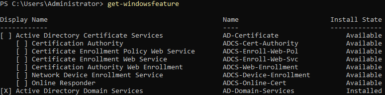
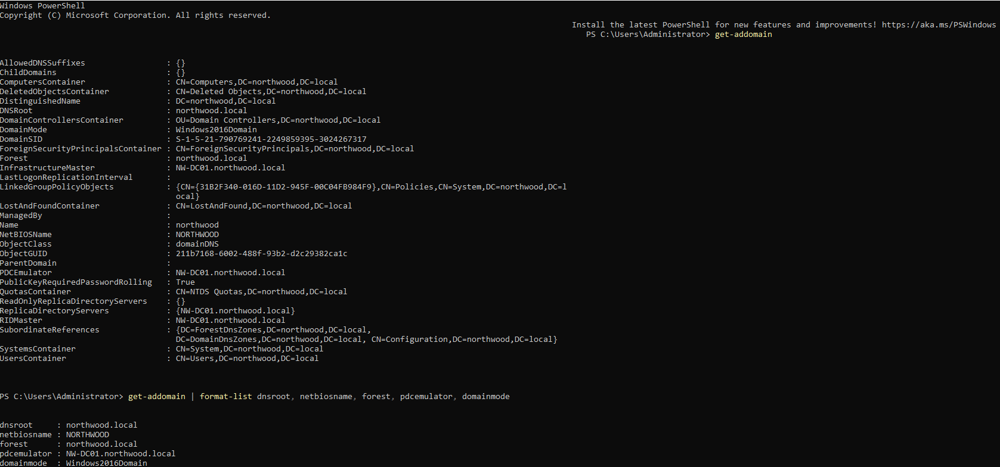
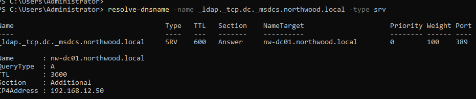
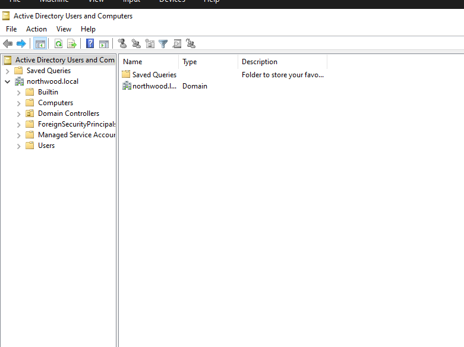

# Phase 2 – AD DS Installation & Domain Controller Promotion

**Goal:** Turn NW-DC01 from a standalone Windows Server into the first domain controller of a new Active Directory forest for Northwood Regional Health.

**Status:** ✅ Complete

---

## Environment

| Item | Value |
|---|---|
| Server | NW-DC01 |
| OS | Windows Server 2022 Standard Evaluation (Desktop Experience) |
| Hypervisor | VirtualBox 7.1.8 (Windows host) |
| IP address | 192.168.12.50 (static) |
| DNS | Points to itself |
| Domain (FQDN) | `northwood.local` |
| NetBIOS name | `NORTHWOOD` |
| Forest / domain | New forest, first DC |

---

## Background: What AD DS Is

Active Directory Domain Services (AD DS) is the Windows Server role that lets a server act as a **domain controller (DC)**, the central authority for identities in an organization.

| Function | What it does |
|---|---|
| Stores identities | One directory database (`NTDS.dit`) holds all users, computers, and groups |
| Authenticates | Domain-joined machines verify logins against the DC (Kerberos) |
| Authorizes | Group membership controls access to resources |
| Organizes | Organizational Units (OUs) structure objects, e.g. by department |
| Enforces policy | Group Policy Objects (GPOs) push settings to users and computers |
| Relies on DNS | Clients locate DCs through DNS SRV records |

**Installing the role is not the same as promoting the server.** Installing adds the software and tools; promotion creates the domain, builds the directory database, configures DNS, and reboots.

---

## Steps

### 1. Verify the computer name

The VirtualBox VM name does not set the Windows hostname, and renaming a DC after promotion is difficult, so the name was confirmed first.

```powershell
hostname
```

**Result:** `NW-DC01`, no rename needed.

### 2. Install the AD DS role

```powershell
Install-WindowsFeature AD-Domain-Services -IncludeManagementTools
```

Installs the AD DS role plus management tools (Active Directory Users and Computers, the AD PowerShell module, etc.).

**Expected result:** `Success: True`, `Restart Needed: No`

Verified afterward with:

```powershell
Get-WindowsFeature AD-Domain-Services
```

**Result:** ✅ `[X] Active Directory Domain Services` shows `Installed`.

### 3. Promote to domain controller (new forest)

```powershell
Install-ADDSForest -DomainName "northwood.local" -DomainNetbiosName "NORTHWOOD" -InstallDns
```

| Prompt / event | Action |
|---|---|
| SafeModeAdministratorPassword | Set a strong DSRM (Directory Services Restore Mode) password, stored securely outside the repo |
| Confirmation | `A` (Yes to All) |
| DNS delegation / cryptography warnings | Expected in a new lab forest; safe to ignore |
| Reboot | Automatic; first boot takes several minutes |

After reboot, logged in as `NORTHWOOD\Administrator`.

### 4. Verify the domain

```powershell
Get-ADDomain
```

| Field | Expected value | Result |
|---|---|---|
| `DNSRoot` | `northwood.local` | ✅ |
| `NetBIOSName` | `NORTHWOOD` | ✅ |
| `PDCEmulator` | `NW-DC01.northwood.local` | ✅ |

### 5. Verify DNS SRV records

Clients find domain controllers through DNS SRV records. If these are missing, machines cannot join the domain.

```powershell
Resolve-DnsName -Name _ldap._tcp.dc._msdcs.northwood.local -Type SRV
```

**Result:** ✅ SRV record points to `NW-DC01.northwood.local` on port 389 (192.168.12.50).

### 6. Install VirtualBox Guest Additions

Installed to enable a shared clipboard between host and VM, plus better display and mouse integration.

1. VM window menu: **Devices → Insert Guest Additions CD image…**
   (If the menu bar is hidden, press **Right Ctrl + Home**.)
2. In the VM, ran `D:\VBoxWindowsAdditions-amd64.exe`
   (amd64 is the correct build because Server 2022 is 64-bit x86 only.)
3. Accepted driver prompts and rebooted.
4. **Devices → Shared Clipboard → Bidirectional**

---

## Troubleshooting Notes

| Issue | Fix |
|---|---|
| Ctrl+C does not copy out of the VM | Shared clipboard requires Guest Additions (step 6) |
| Shared clipboard still not working after Guest Additions | Unresolved. `VBoxService` and `VBoxTray` both running, clipboard set to Bidirectional, toggle tried. Workaround: type commands manually and take screenshots from the host with Win + Shift + S |
| `Resolve-DnsName` prompted for `Name` | The name argument was lost; rerun with an explicit `-Name` parameter on one line |
| VirtualBox menu bar not visible | VM is in full-screen/scaled mode; press **Right Ctrl + Home** for the popup menu, or **Right Ctrl + F** to exit full-screen |
| Guest Additions installer did not open on double-click | Launched it from an elevated PowerShell instead |
| Copying text in PowerShell | Highlight and press Enter or right-click; Ctrl+C with nothing selected cancels the running command |

---

## Screenshots

**AD DS role installed**


**Domain verification (Get-ADDomain)**


**DNS SRV record check**


**Active Directory Users and Computers – Domain Controllers**


---

## Next: Phase 3

Build the OU structure for the departments: **Clinical, Administration, IT, Facilities**.