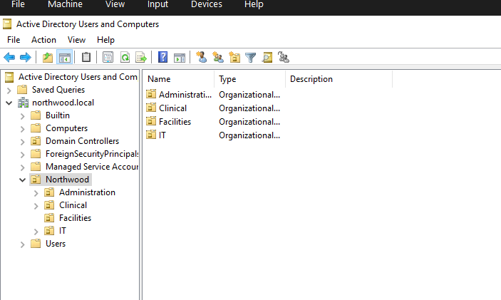
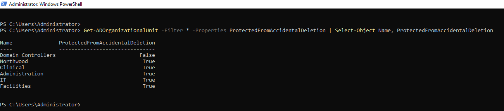

# Phase 3 – OU Structure

**Goal:** Build the Organizational Unit (OU) structure for Northwood Regional Health so users, computers, and Group Policy can be organized by department.

**Status:** ✅ Complete

---

## Design

```
northwood.local
└── Northwood
    ├── Administration
    ├── Clinical
    ├── Facilities
    └── IT
```

| Decision | Why |
|---|---|
| One top-level `Northwood` OU | Keeps Northwood's objects separate from the built-in containers, and gives one place to apply policy to all staff |
| One OU per department | Matches the org chart, and lets each department get its own GPOs in Phase 5 |
| Protection from accidental deletion left on | Deleting an OU deletes everything inside it; protection prevents that by mistake |

---

## Background: Containers vs OUs

The default folders in a new domain (`Users`, `Computers`, `Builtin`) are **containers**, not OUs.

| | Container (e.g. `Users`) | OU (e.g. `Clinical`) |
|---|---|---|
| Created by | Windows, automatically | An admin |
| Can link a GPO | No | Yes |
| Can hold OUs | No | Yes |
| Icon in ADUC | Plain folder | Folder with a small icon |

`Domain Controllers` is the only OU that exists by default.

---

## Steps

### 1. Create the OUs in the GUI

In **Server Manager → Tools → Active Directory Users and Computers**:

1. Right-click **northwood.local → New → Organizational Unit**, named `Northwood`.
2. Right-click **Northwood → New → Organizational Unit** for each department: `Clinical`, `Administration`, `IT`, `Facilities`.

"Protect container from accidental deletion" was left checked for every OU.

### 2. View the OUs with PowerShell

```powershell
Get-ADOrganizationalUnit -Filter * | Select-Object Name, DistinguishedName
```

**Result:** 6 OUs — the 5 created above, plus the built-in `Domain Controllers`. Containers like `Users` are not listed because they are not OUs.

#### Distinguished Names (DNs)

A DN is an object's unique full address in AD, read from most specific to most general:

```
OU=Clinical,OU=Northwood,DC=northwood,DC=local
```

| Piece | Meaning |
|---|---|
| `OU=Clinical` | The Clinical OU |
| `OU=Northwood` | Inside the Northwood OU |
| `DC=northwood,DC=local` | In the `northwood.local` domain (`DC` = Domain Component) |

PowerShell uses DNs to know exactly where to find or create an object.

### 3. Test deletion protection

Tried to delete `Facilities` in ADUC.

**Result:** Blocked: *"You do not have sufficient privileges to delete Facilities, or this object is protected from accidental deletion."*

Protection adds a Deny Delete permission for Everyone, which overrides even Domain Admin rights.

### 4. Remove protection, delete, and recreate with PowerShell

Turn off protection:

```powershell
Set-ADOrganizationalUnit -Identity "OU=Facilities,OU=Northwood,DC=northwood,DC=local" -ProtectedFromAccidentalDeletion $false
```

Confirm the setting:

```powershell
Get-ADOrganizationalUnit -Identity "OU=Facilities,OU=Northwood,DC=northwood,DC=local" -Properties ProtectedFromAccidentalDeletion | Select-Object Name, ProtectedFromAccidentalDeletion
```

Deleted `Facilities` in ADUC, then recreated it:

```powershell
New-ADOrganizationalUnit -Name "Facilities" -Path "OU=Northwood,DC=northwood,DC=local"
```

`-Path` is the DN of the parent OU (Northwood), not of Facilities itself.

**Finding:** The recreated OU was protected (`True`) even though the command didn't mention protection. `New-ADOrganizationalUnit` turns protection on by default.

### 5. Verify all OUs

```powershell
Get-ADOrganizationalUnit -Filter * -Properties ProtectedFromAccidentalDeletion | Select-Object Name, ProtectedFromAccidentalDeletion
```

**Result:** ✅ All 6 OUs show `True`.

---

## Troubleshooting Notes

| Issue | Cause | Fix |
|---|---|---|
| VM froze while working in ADUC | Not determined; 4 GB RAM is the minimum for Server 2022 with the GUI | Powered off from VirtualBox Manager (**Close → Power Off**) and restarted; AD came back cleanly |
| Delete still blocked after running `Set-ADOrganizationalUnit` | Typo in the command, so protection was never removed | Checked the setting with `Get-ADOrganizationalUnit -Properties`, which still showed `True`; reran the command correctly |
| `A positional parameter cannot be found that accepts argument '-'` | A space between the dash and the parameter name (`- Properties`) | Parameter names attach directly to the dash: `-Properties` |
| `ProtectedFromAccidentalDeletion` missing from output | The `-Properties` parameter didn't apply, so only default fields were shown | Requested the property explicitly and used `Select-Object` to show only the needed columns |
| ADUC didn't show changes made in PowerShell | ADUC shows a snapshot and doesn't update itself | Refreshed with **F5** |

---

## Screenshots

**OU structure in ADUC**


**All OUs protected from accidental deletion**


---

## Next: Phase 4

Bulk-create 40–50 users from a CSV with PowerShell, placed into the department OUs, and create security groups for each department.