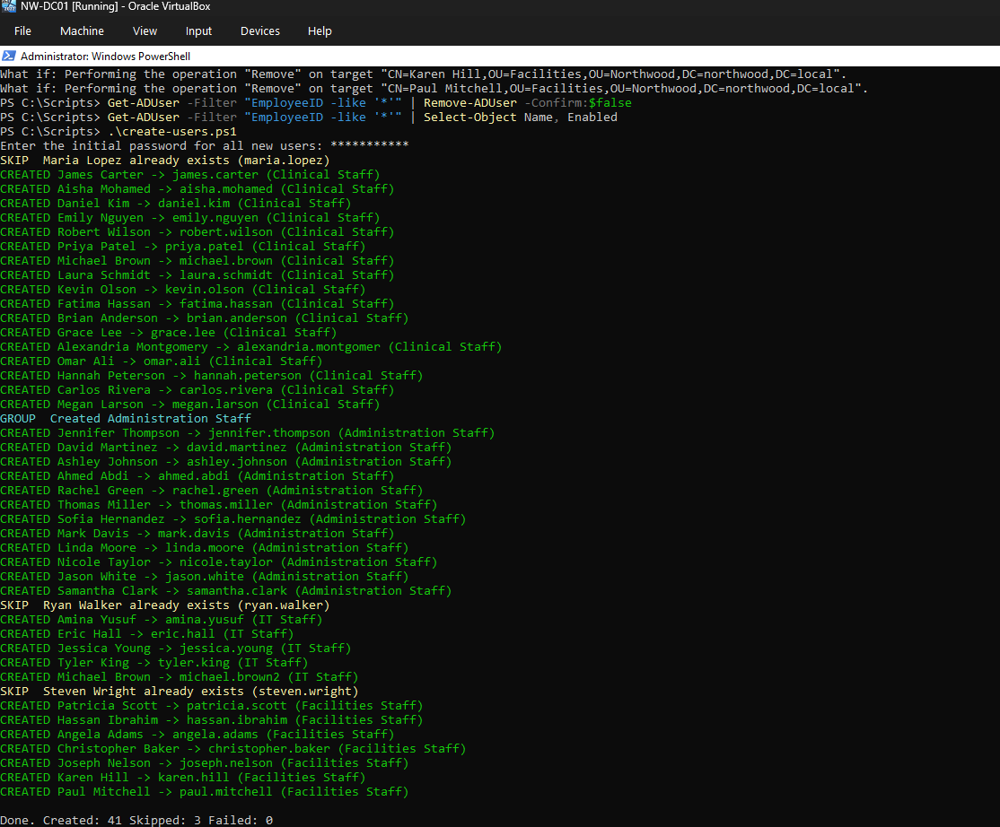
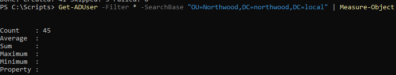
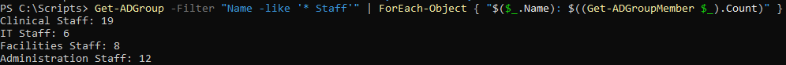
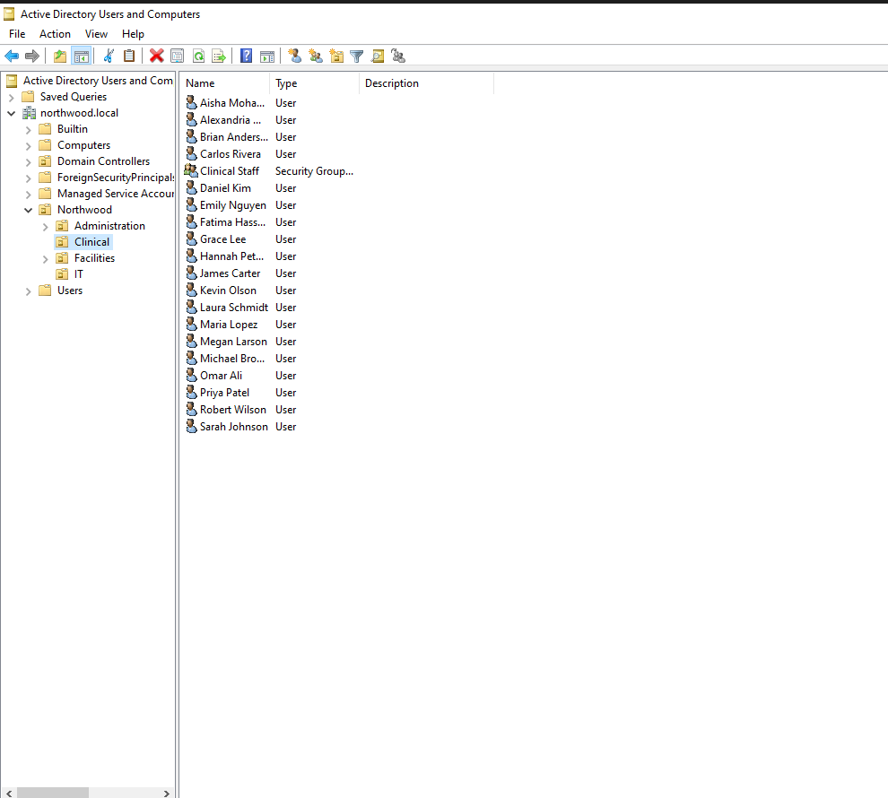

# Phase 4 - Users and Groups

**Goal:** Create Northwood's staff accounts and department security groups, first by hand and then in bulk from a CSV with PowerShell.

**Status:** ✅ Complete

---

## Result

| Item | Count |
|---|---|
| Users created | 45 (1 by hand, 3 with PowerShell one-liners, 41 by script) |
| Security groups | 4: Clinical Staff, Administration Staff, IT Staff, Facilities Staff |

| Group | Members |
|---|---|
| Clinical Staff | 19 |
| Administration Staff | 12 |
| IT Staff | 6 |
| Facilities Staff | 8 |

Script and data: [`scripts/create-users.ps1`](../scripts/create-users.ps1) and [`scripts/users.csv`](../scripts/users.csv)

---

## Design Decisions

| Decision | Why |
|---|---|
| Username format `first.last` | Readable, and matches email-style addresses |
| Duplicate names get a number (`michael.brown2`) | Two staff can share a name; usernames must be unique |
| `SamAccountName` trimmed to 20 characters | The pre-Windows 2000 logon name has a 20-character limit; the full name is kept in the UPN |
| One security group per department (`<Department> Staff`) | Groups control access to resources; OUs control where GPOs apply |
| New users must change password at first logon | Admins never know a user's real password |
| Initial password entered at runtime, never stored | The script is public on GitHub |
| `EmployeeID` on every scripted account | A unique HR ID lets the script safely skip people who already exist |

---

## Background: OU vs. Group

| | OU (e.g. `Clinical`) | Security group (e.g. `Clinical Staff`) |
|---|---|---|
| Purpose | Where an account **lives** | What an account **can access** |
| Used for | Linking GPOs | Permissions on shares, apps, printers |
| A user can be in | Exactly one | Many |

---

## Steps

### 1. Create one user and group by hand

In **Active Directory Users and Computers**:

1. Right-click **Clinical → New → User**: Sarah Johnson, logon name `sarah.johnson`.
2. Right-click **Clinical → New → Group**: `Clinical Staff`, Global, Security.
3. Added Sarah on the group's **Members** tab.

Verified with PowerShell:

```powershell
Get-ADUser -Identity sarah.johnson
Get-ADGroupMember -Identity "Clinical Staff"
```

### 2. Build the logic with a 3-person test CSV

Created `C:\Scripts\test-users.csv` and built the script one piece at a time:

| Piece | Command |
|---|---|
| Read the CSV | `$users = Import-Csv C:\Scripts\test-users.csv` |
| Loop over each person | `foreach ($person in $users) { ... }` |
| Build the username | `$username = "$($person.FirstName).$($person.LastName)".ToLower()` |
| Build the OU path | `$ouPath = "OU=$($person.Department),OU=Northwood,DC=northwood,DC=local"` |
| Preview safely | `New-ADUser ... -WhatIf` |
| Store the password securely | `$password = Read-Host "Enter initial password" -AsSecureString` |
| Create users | `New-ADUser -Name ... -SamAccountName ... -UserPrincipalName ... -Path $ouPath -AccountPassword $password -Enabled $true -ChangePasswordAtLogon $true` |
| Create groups | `New-ADGroup -Name "IT Staff" -GroupScope Global -GroupCategory Security -Path "OU=IT,..."` |
| Add to groups | `Add-ADGroupMember -Identity "$($person.Department) Staff" -Members $username` |

### 3. Write the full script

[`create-users.ps1`](../scripts/create-users.ps1) combines those pieces and adds:

| Feature | Why |
|---|---|
| Skip check (EmployeeID, or same name in the same OU) | Safe to rerun; no duplicate accounts |
| Duplicate-name numbering and 20-character trimming | Enforces the naming rules |
| Creates a department group if it doesn't exist | No manual group setup |
| `try` / `catch` with `-ErrorAction Stop` | Every failure prints **FAILED** with the reason instead of failing silently |
| CREATED / SKIP / FAILED line per user, plus totals | Shows exactly what happened |

### 4. Run it on NW-DC01

Files were written in VS Code on the host, shared to the VM with a VirtualBox shared folder (read-only, auto-mount), and copied to `C:\Scripts` before running.

```powershell
cd C:\Scripts
.\create-users.ps1
```

**Result:** `Done. Created: 41 Skipped: 3 Failed: 0`

### 5. Verify

```powershell
Get-ADUser -Filter * -SearchBase "OU=Northwood,DC=northwood,DC=local" | Measure-Object
```

**Result:** ✅ 45 users

```powershell
Get-ADGroup -Filter "Name -like '* Staff'" | ForEach-Object { "$($_.Name): $((Get-ADGroupMember $_).Count)" }
```

**Result:** ✅ Clinical 19, Administration 12, IT 6, Facilities 8

```powershell
Get-ADUser -Filter "Surname -eq 'Montgomery'" | Select-Object Name, SamAccountName, UserPrincipalName
```

**Result:** ✅ `SamAccountName` trimmed to `alexandria.montgomer`; UPN keeps the full `alexandria.montgomery@northwood.local`

---

## Troubleshooting Notes

| Issue | Cause | Fix |
|---|---|---|
| Group-add loop did nothing | `$users` was empty; variables don't carry over to a new PowerShell window | Reloaded with `Import-Csv` |
| `Cannot find an object with identity: ' Staff'` | Misspelled property (`Departtment`) returns empty instead of an error | Fixed the spelling; the error text `' Staff'` pointed to the empty value |
| Facilities Staff group in the IT OU | Edited the group name but not `-Path` | `Get-ADGroup "Facilities Staff" \| Move-ADObject -TargetPath "OU=Facilities,..."` |
| Steven Wright never created, no visible error | The error scrolled past unnoticed | Recreated him; added per-user CREATED/FAILED output to the script |
| ADUC didn't show Maria | ADUC shows a snapshot | Refreshed with **F5**; confirmed with `Get-ADUser` |
| Script ran but did nothing | Files were 0 bytes because they weren't saved in VS Code before copying | Saved with **Ctrl + S**, recopied, checked sizes with `Get-ChildItem` |
| 41 users FAILED: password does not meet requirements | Initial password failed domain complexity rules | Reran with a stronger password |
| Failed users left behind as disabled accounts | `New-ADUser` creates the account before setting the password | Found them with `Get-ADUser -Filter "EmployeeID -like '*'"`, previewed with `Remove-ADUser -WhatIf`, then removed them before rerunning |

**Lesson:** A script that runs without errors isn't proof it worked. Print a result for every item and verify the totals afterward.

---

## Screenshots

**Script output**


**User count**


**Group member counts**


**Clinical OU in ADUC**


---

## Next: Phase 5

Create GPOs and link them to the department OUs, such as password and screen-lock policies for Clinical.