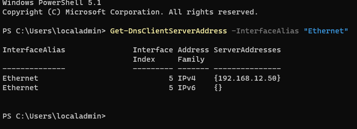
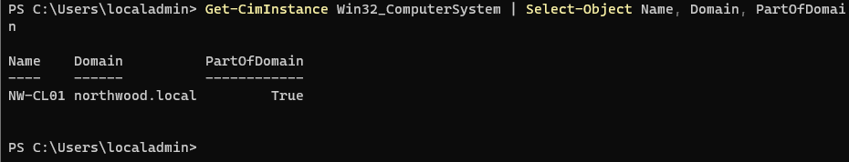
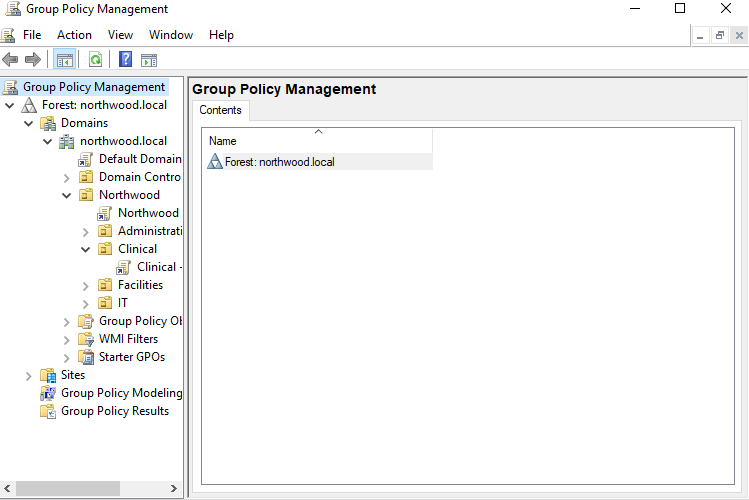
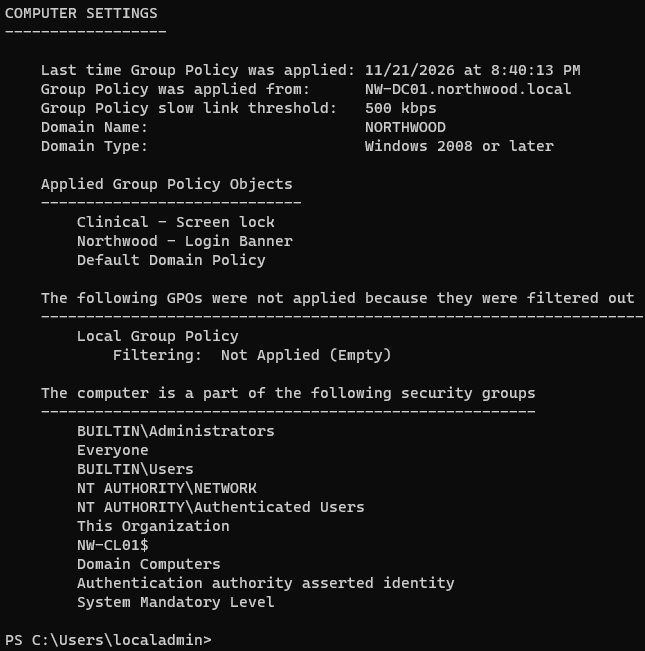
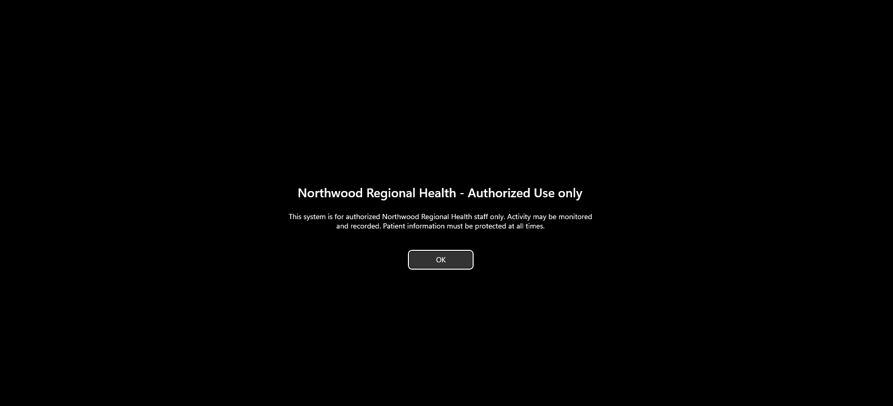

# Phase 5 – Client PC and Group Policy

**Goal:** Add a staff workstation to Northwood, join it to the domain, sign in as a domain user, and apply department-based security rules with Group Policy.

**Status:** ✅ Complete

---

## Result

| Item | Result |
|---|---|
| Client PC | NW-CL01, Windows 11 Enterprise, joined to `northwood.local` |
| Domain sign-in | `NORTHWOOD\maria.lopez` signed in successfully |
| NW-CL01 location in AD | `OU=Clinical,OU=Northwood,DC=northwood,DC=local` |
| GPOs created | **Northwood - Login Banner** (linked to Northwood), **Clinical - Screen Lock** (linked to Clinical) |
| Verified | `gpresult` showed both GPOs applied; the banner appeared at sign-in; the screen locked after 5 idle minutes |

---

## Design Decisions

| Decision | Why |
|---|---|
| Windows 11 **Enterprise** Evaluation (not Home or LTSC) | Home can't join a domain; LTSC is for special-purpose devices. Enterprise matches a standard staff PC |
| Local account `localadmin` created during setup | A backup way in if a domain sign-in ever fails. Standard IT practice |
| NW-CL01 gets its IP from DHCP | Staff PCs normally get addresses automatically; only servers need static IPs |
| NW-CL01's DNS set to the DC (192.168.12.50) | Clients find the domain through SRV records that only the DC's DNS holds |
| NW-CL01 moved into the **Clinical** OU | GPOs can't be linked to the default `Computers` container. NW-CL01 represents a nurse-station PC |
| Login banner linked to the **Northwood** OU | Inherits down to every department |
| Screen lock linked to the **Clinical** OU | Applies only to Clinical, protecting patient info on shared PCs |
| Both settings are **Computer** settings | They protect the PC regardless of who signs in; the banner shows before anyone signs in |

---

## Background: Group Policy

A **GPO (Group Policy Object)** is a set of rules created once on the domain controller and applied automatically to the computers and users it targets.

| Concept | Meaning |
|---|---|
| Link | A GPO applies to the OU it's linked to |
| Inheritance | A GPO also applies to everything **under** that OU |
| Computer Configuration | Follows the PC, based on the computer's OU |
| User Configuration | Follows the person, based on the user's OU |
| `gpupdate /force` | Makes a PC download its GPOs now instead of waiting ~90 minutes |
| `gpresult /r` | Shows which GPOs actually applied |

```
northwood.local                  ← Default Domain Policy (password rules, all of AD)
└── Northwood                    ← Northwood - Login Banner
    ├── Administration
    ├── Clinical                 ← Clinical - Screen Lock
    │   ├── Maria Lopez (user)
    │   └── NW-CL01 (computer)
    ├── Facilities
    └── IT
```

---

## Steps

### 1. Create NW-CL01

VirtualBox VM: Windows 11 Enterprise Evaluation, 4 GB RAM, 2 CPUs, 64 GB dynamically allocated VDI, EFI, TPM 2.0, Secure Boot, Bridged Adapter. Installed manually (unattended install off), with a local account created through **Sign-in options → Domain join instead**.

### 2. Point DNS at the domain controller

Admin PowerShell on NW-CL01:

```powershell
Set-DnsClientServerAddress -InterfaceAlias "Ethernet" -ServerAddresses 192.168.12.50
```

### 3. Test the connection to the DC

```powershell
Resolve-DnsName northwood.local
Test-NetConnection 192.168.12.50 -Port 389
```

**Result:** ✅ Resolved to 192.168.12.50; `TcpTestSucceeded : True` (port 389 = LDAP, used by Active Directory).

### 4. Join the domain and rename

```powershell
Add-Computer -DomainName northwood.local -NewName NW-CL01 -Credential NORTHWOOD\Administrator -Restart
```

The join succeeded but the rename failed ("directory service is busy"), so the rename was retried:

```powershell
Rename-Computer -NewName NW-CL01 -DomainCredential NORTHWOOD\Administrator -Restart
```

### 5. Sign in as a domain user

Maria's password was reset from NW-DC01, then she signed in to NW-CL01 as `NORTHWOOD\maria.lopez`.

```powershell
Set-ADAccountPassword -Identity maria.lopez -Reset -NewPassword (Read-Host "New password" -AsSecureString)
```

### 6. Move NW-CL01 into the Clinical OU

On NW-DC01:

```powershell
Get-ADComputer NW-CL01 | Move-ADObject -TargetPath "OU=Clinical,OU=Northwood,DC=northwood,DC=local"
```

### 7. Create the GPOs

In **Server Manager → Tools → Group Policy Management**:

| GPO | Linked to | Setting (Computer Configuration → Policies → Windows Settings → Security Settings → Local Policies → Security Options) | Value |
|---|---|---|---|
| Northwood - Login Banner | Northwood OU | Interactive logon: Message title for users attempting to log on | Northwood Regional Health - Authorized Use Only |
| | | Interactive logon: Message text for users attempting to log on | Authorized-use and patient-privacy notice |
| Clinical - Screen Lock | Clinical OU | Interactive logon: Machine inactivity limit | 300 seconds (5 minutes) |

### 8. Apply and verify

On NW-CL01, as Maria:

```powershell
gpupdate /force
```

Admin PowerShell on NW-CL01:

```powershell
gpresult /r /scope computer
```

**Result:** ✅ Applied Group Policy Objects: **Clinical - Screen Lock**, **Northwood - Login Banner**, **Default Domain Policy**.

### 9. Test the behavior

| Test | Result |
|---|---|
| Sign out and back in | ✅ Login banner appeared before sign-in |
| Leave the PC idle for 5 minutes | ✅ Screen locked |

---

## Troubleshooting Notes

| Issue | Cause | Fix |
|---|---|---|
| NW-CL01 showed a black screen at startup; VirtualBox showed a turtle icon | Virtualization-Based Security on the host kept Hyper-V running, forcing VirtualBox into slow fallback mode | Turned off Memory Integrity, Hyper-V Windows features, set `bcdedit /set hypervisorlaunchtype off`, and set `EnableVirtualizationBasedSecurity` to 0 in the registry. Confirmed with `msinfo32` |
| `Set-DnsClientServerAddress`: permission denied (CimException) | PowerShell wasn't running as Administrator | Reopened PowerShell with **Run as administrator** |
| Domain join failed: "The specified network name is no longer available" | The router also handed out an IPv6 DNS server, which doesn't know `northwood.local` | Disabled IPv6 on the client adapter and cleared the DNS cache |
| Rename failed: "directory service is busy" | The DC was still processing the join | Retried with `Rename-Computer` |
| Maria's password unknown | Set at an earlier hidden prompt; AD never stores readable passwords | Admin reset with `Set-ADAccountPassword -Reset` |
| Admin prompt: "domain isn't available" | Windows tried to check `localadmin` with the unreachable domain | Used `NW-CL01\localadmin` to force a local sign-in |
| `gpupdate`: "lack of network connectivity to a domain controller" | NW-CL01 had a **169.254.x.x** (APIPA) address: no DHCP answer | Ruled out VirtualBox settings, host network, and an IP conflict; NW-DC01 could reach the router. Set a static IP (192.168.12.60) to restore the connection |
| Connection dropped again later | Bridged networking over the host's Wi-Fi (Intel AX211) is unreliable; bridging isn't part of the Wi-Fi standard and depends on the adapter, driver, and access point | Short term: static IP. Long term: wired Ethernet or an isolated VirtualBox NAT Network (Phase 6) |

**Lesson:** A domain problem is often a network problem underneath. Check for an IP address and DNS before troubleshooting Group Policy.

---

## Screenshots

**Client DNS points to the DC**


**NW-CL01 joined to the domain**


**GPO links in Group Policy Management**


**GPOs applied to NW-CL01**


**Login banner**


---

## Project Status

Phase 5 completes the planned build: a domain controller, department OUs, 45 users and security groups, a domain-joined client, and department-based Group Policy.